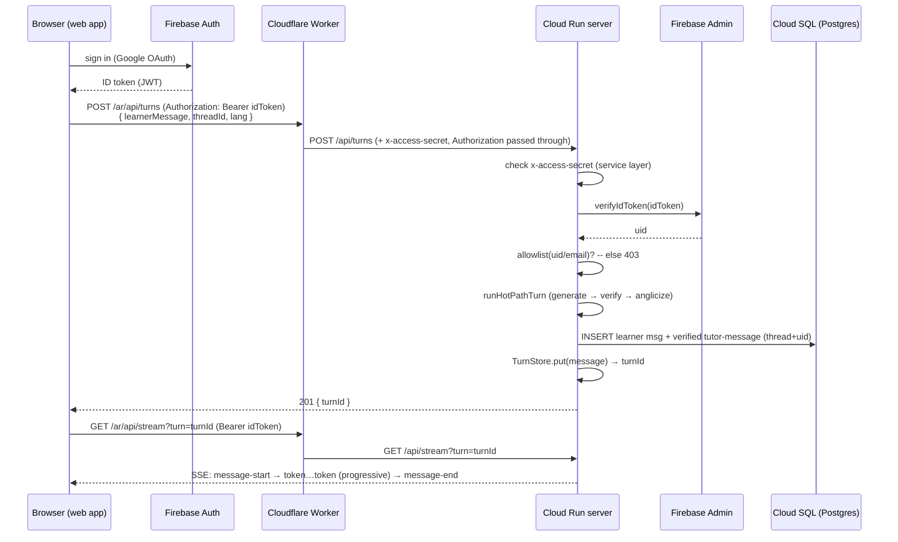

# Design — App Shell (accounts · live composer · session persistence)

**Status:** draft for review · **Date:** 2026-07-04 · **Epic:** [#53](https://github.com/julianken/language-agent/issues/53) · **Feeds:** brainstorm → this design spec → epic issue authoring → implementation

> The layer that turns the walking skeleton from a demo into an app: a signed-in
> learner, a real composer wired into the **already-existing** turn loop, and the
> datastore Phase 0 deliberately skipped — so a session finally survives. It is the
> hard prerequisite for `learner-model-blend` (the per-`(user, lemma, sense)`
> `word_state` has no user to key off and nowhere to live until this lands —
> architecture.md §8 Phase A / Phase 3).
>
> This document writes up decisions already settled in the brainstorming pass and
> grounds each against the current tree and the source specs
> ([`docs/plans/architecture.md`](../../plans/architecture.md) §3/§6/§8,
> [`docs/plans/v2-app-flow-plan.md`](../../plans/v2-app-flow-plan.md),
> [`DESIGN.md`](../../../DESIGN.md)). It is a **design** doc — no implementation code,
> no task-by-task plan (that is the writing-plans step next).

## Decisions locked in brainstorming

| # | Question | Decision |
|---|----------|----------|
| 1 | Scope | **The complete App shell as epic #53 defines it** — both auth methods, the full 3-step onboarding, the full persistent shell + Settings (incl. Privacy & data export/delete), threads, persistence, both instances. Nothing is deferred; the only OUT items are the neighbouring epics' own boundaries (§2). |
| 2 | Auth mechanism | **Firebase Auth / Identity Platform (GCP-native).** Google OAuth **and** email magic-link (both Firebase providers). ID token (JWT) verified server-side with the Firebase Admin SDK; the **Firebase UID** is the stable per-user key. |
| 3 | Auth topology | **Two independent layers.** The existing per-instance `x-access-secret` stays as the **service-to-service** lock on the raw `run.app`; the Firebase **ID token** is the new **user-identity** layer. An **optional** server-side access gate (allowlist / invite) is available as an operator launch control — off ⇒ open create-account; it is a config, not a scope cut. |
| 4 | Datastore | **Cloud SQL (Postgres), GCP-native.** Relational — natural for threads/messages/events/settings and the eventual `word_state` + mastery graph. Terraform-managed; password via GCP Secret Manager as a Cloud Run env var, never in TF code/state. (Firestore + Neon rejected — see §10.) |
| 5 | Composer | The `compose-bar` posts to the **existing** `POST /api/turns`, then streams the reply via the **existing** `GET /api/stream?turn=<id>` SSE path. Reuse the existing `<TokenStream>` renderer and the blend-dependent base direction. Reply-content quality is **out of scope** (that is `generation-quality`). |
| 6 | Persistence posture | Persist the learner message and the verified `tutor-message` to Postgres, keyed to thread+user — **superseding `TurnStore`** as the durable record for signed-in learners. `TurnStore` remains only the transient in-request replay buffer. |

---

## 1. Overview / North-star

**North-star:** a learner opens `lexercon.com/ar` (or `/zh`), signs in with Google,
types a message into a real composer, and watches a verified blended reply stream
token-by-token — and when they come back tomorrow (or the server restarts), their
threads, messages, and learning events are still there, keyed to their identity.

Three parts, exactly as architecture.md §8 Phase A frames them:

1. **Accounts / auth** — a stable **per-user identity** (the key the entire learner
   model hangs off).
2. **Live composer** — a real input that POSTs a learner message and streams the
   reply back, wiring the **existing** `POST /api/turns` → `GET /api/stream?turn=<id>`
   loop into the UI (today the web app only *replays* `?fixture=` / `?turn=` from
   the URL — `src/apps/web/src/app/App.tsx`).
3. **Session persistence** — the datastore behind message history, learning events,
   settings, and the Phase-3 `word_state` **table shape**.

This is foundational, not cosmetic, and it **interleaves** with the pedagogy phases
rather than following them. It ships the app shell **complete** — every surface epic
#53 scopes (both auth methods, the full onboarding, the full tool-rail + Settings incl.
export/delete). The only things left to other epics are their own boundaries (§2 OUT).

Proven on **both** instances (ar + zh) — the shell chrome is language-neutral; the
only per-language behavior is the blend-dependent conversation base direction, which
is pack-computed, never shell-set (DESIGN.md `app-shell`).

---

## 2. Scope

The **complete App shell** as epic #53 defines it. Everything in the epic's **In** list
is IN here — none of it deferred. The only items left out are the neighbouring epics'
own boundaries (the epic's own **Out**).

### IN — the full App shell

- **Accounts / auth — both methods.** Google OAuth **and** email magic-link (v2-app-flow
  `A1`/`A2`): sign-in + create-account + sign-out + Account/Profile. Real accounts,
  public-capable. An operator-controlled access gate (allowlist / invite) exists as
  **configuration** — a launch control the operator sets, *not* a scope cut; the auth
  itself ships complete.
- **The composer → turn-loop → SSE round-trip on BOTH instances.** `compose-bar` posts
  `{ learnerMessage, threadId, lang }` to the existing `POST /api/turns`; the reply
  streams via the existing `GET /api/stream?turn=<id>` with anti-buffering headers and
  tokens-first ordering intact, rendered by the existing `<TokenStream>` and the
  blend-dependent base direction.
- **Cloud SQL provisioned via Terraform** + all core tables (§5).
- **Threads** — multi-turn conversations + a sidebar thread list + New chat; durable
  learning-event ingestion behind the existing shared route.
- **The full 3-step onboarding O1–O3** — `O1` goal/language confirm → `O2` no-quiz word
  seeding (tap recognized words; seeds the confirmed set + the opening vocab dial) →
  `O3` pace defaults with a **live first-blend preview**; plus the first-run chat home
  (greeting, suggested prompts, empty state). A returning user skips onboarding.
- **The persistent shell** — the collapsible left tool-rail / sidebar (threads, word
  list, persona, progress, settings — the 240px canonical rail, v2-app-flow §1.2),
  `persona-header` (surface built; the persona *character/content* is the epic's own
  open product question — §12, space reserved, neutral until decided), and **Settings
  incl. Privacy & data (working export / type-to-confirm delete against the real
  datastore) + Account/Profile**.
- **Persistence** — threads, messages, and learning events survive sign-out/sign-in
  **and** a server restart; datastore-backed, not process memory.
- **Schema discipline** — `schemaVersion` + tolerant reader on persisted payloads;
  stand-off annotations keyed to stable token IDs, never character offsets (§5).
- **The blend-direction rule** (DESIGN.md `app-shell`; reuse the existing token
  renderer, do not rebuild) — proven on **both** instances (ar + zh).
- **Control-cluster placeholders** — the composer's Attach · Web-search · Keyboard
  cluster renders as placeholders (per the epic); their *pipelines* are later epics
  (`interactive-lookup-audio`, `writing-correction`), but the surface ships here.

### OUT (owned by neighbouring epics)

- **Reply content quality** — making the live reply an actual verified *blend* instead
  of the 100%-English fallback is `generation-quality` (#52). **This epic's composer
  must ship and work regardless of reply content.** (Today a typed message streams a
  100%-English reply; never-show-wrong holds — server.ts header.)
- Word-card click/lookup + per-word audio (`interactive-lookup-audio`); corrections +
  the trainer keyboard's real behavior + the zh input decision (`writing-correction`);
  the FSRS scheduler + any *consumer* of `word_state` (`learner-model-blend`); zh gate
  depth + the #22 neural-leg wake (`content-verification-depth` — see §11);
  min_instances / cold-start / image rolls / CI freshness (`platform-ops-hardening`).

---

## 3. Architecture

### 3.1 The two auth layers (independent, both enforced at the server)

| Layer | Purpose | Carried by | Verified where | Failure |
|---|---|---|---|---|
| **Service-to-service secret** (existing, unchanged) | Locks the raw `run.app` so only the Worker can reach `/api/*` | `x-access-secret: <per-instance secret>` injected by the Worker | `server.ts` gate: rejects `/api/*` (except `/api/health`) lacking the secret | `403` |
| **User identity** (new) | Who the learner is; the stable per-user key | `Authorization: Bearer <Firebase ID token>` set by the web app | New auth-verify middleware in the server: `verifyIdToken` (Firebase Admin) → UID; then allowlist check | `401` (no/invalid/expired token) · `403` (valid token, not allowlisted) |

The two are orthogonal: the service secret proves *the request came through the Worker*;
the ID token proves *which learner sent it*. Neither substitutes for the other. The
per-instance `x-access-secret` (`SHARED_SECRET_AR` / `SHARED_SECRET_ZH`,
`infra/worker/router-worker.js`) stays exactly as-is.

### 3.2 The request path (web → Worker → Cloud Run)

Grounded in the current tree — the **only** Worker/transport change needed is that the
Worker must forward the `Authorization` header:

- The web app obtains a Firebase ID token client-side (Firebase Auth JS SDK, Google
  OAuth) and sets `Authorization: Bearer <idToken>` on every `/api/*` call.
- The **Cloudflare Worker** (`router-worker.js`) proxies `/ar/*` and `/zh/*` to the
  matching Cloud Run host, strips the one-segment prefix, and **keeps injecting**
  `x-access-secret`. It builds the proxied request via `new Request(target, request)`,
  which **already copies inbound headers** — so `Authorization` passes through with no
  code change; the Worker only needs to not strip it (it does not today). *(Verified:
  the Worker sets `x-access-secret` and `Host`, leaving all other copied headers intact
  — `router-worker.js` lines 66–77.)*
- The **Cloud Run Node/TS server** runs both gates: the existing shared-secret check,
  then the new auth-verify middleware (`verifyIdToken` → UID → allowlist). `/api/health`
  stays open for Cloud Run liveness (unchanged).

### 3.3 Where persistence hooks in

`POST /api/turns` today runs `runHotPathTurn` (generate → verify → anglicize) to
completion and writes the verified `tutor-message` into the **in-memory** `TurnStore`
(capped 1,000, FIFO, self-described as "a transport-proof store, not learner-state
persistence" — `turn-store.ts`). The design adds, in the same handler, **after** the UID
is known and the turn is computed:

1. Persist the **learner message** row and the verified **tutor-message** row to
   Postgres `messages`, both keyed to `thread_id` (which belongs to `user_id`).
2. Still `TurnStore.put(message)` → `turnId` so the **immediate** `?turn=<id>` replay
   works byte-for-byte unchanged (the SSE leg reads `TurnStore`; the wire contract does
   not move).
3. On thread reopen / after a server restart (`TurnStore` empty — `server.ts` documents
   the current 404), history loads from Postgres.

So `TurnStore` is demoted to a hot in-request replay buffer; **Postgres is the durable
record.** Learning events (`POST /api/learning-events`) persist the same contract the
`LearningEventStore` already accepts, now keyed to the signed-in UID (the UID is derived
server-side from the token, **not** added to the request body — the route contract is
unchanged; today's schema carries no user key, confirmed in `learning-events.ts`).

### 3.4 Signed-in turn — sequence

Note the never-show-wrong guarantee sits **upstream** in `runHotPathTurn` (on RED
exhaustion the result is already the all-English fallback — `server.ts` header); nothing
in this design inspects bands, so persistence and auth do not touch that guarantee.

---

## 4. Components

Each unit: what it does · its interface · its dependencies.

- **Composer (`compose-bar`)** — RTL-aware input (DESIGN.md `compose-bar`: `surface-card`,
  `radius/lg`, RTL). *Does:* collects the learner message, POSTs
  `{ learnerMessage, threadId, lang }` to `POST /api/turns`, then opens
  `GET /api/stream?turn=<id>` and paints via the existing `<TokenStream>`. *Interface:*
  the two existing HTTP endpoints (no new turn API); emits the learner text and consumes
  the returned `turnId`. *Deps:* the existing SSE renderer + blend-direction (reuse, do
  not rebuild — the renderer already receives `blend` and `messageLang`, `App.tsx`
  lines ~106–112); the Firebase ID token for the `Authorization` header. The
  Attach / Web-search / Keyboard control-cluster (v2-app-flow `C1`) are **placeholders**.
- **Auth (client)** — Firebase Auth JS SDK, Google OAuth. *Does:* sign-in / sign-out;
  holds the ID token; attaches `Authorization: Bearer <idToken>` to `/api/*` calls and
  refreshes it. *Interface:* Firebase Auth. *Deps:* a Google OAuth client in the GCP
  project (operator dependency, §12).
- **Auth-verify middleware (server)** — *Does:* verifies the ID token with the Firebase
  Admin SDK (`verifyIdToken`), extracts the UID, checks the allowlist; on success sets a
  request-scoped `uid`. *Interface:* runs on `/api/*` (after the shared-secret gate;
  `/api/health` exempt). *Deps:* Firebase Admin SDK; the allowlist (env / Secret
  Manager). *Errors:* `401` for missing/invalid/expired token; `403` for a valid token
  that is not allowlisted (distinct from the shared-secret `403`).
- **Thread / message store (Postgres-backed)** — *Does:* creates threads, appends
  learner + tutor messages, lists a user's threads, loads a thread's history. Supersedes
  `TurnStore` as the durable record; `TurnStore` stays the in-request replay buffer.
  *Interface:* a small server-side repository (create-thread, append-message,
  list-threads, load-thread) called from the `POST /api/turns` handler and a new
  thread-history read path. *Deps:* Cloud SQL connection (§4 Terraform module).
- **Learning-event persistence** — *Does:* persists the exact contract `LearningEvent`
  the `LearningEventStore` already validates (`tokenRef`, `unitRefs`, `renderedScaffold`,
  `payload.schemaId`), now keyed to the UID and thread. *Interface:* the **unchanged**
  `POST /api/learning-events` route contract; the UID is server-derived. *Deps:* Cloud
  SQL; the existing zod validation in `learning-events.ts`.
- **Terraform Cloud SQL module** — *Does:* provisions a Postgres instance + database +
  user; wires the Cloud Run service to it via the Cloud SQL connector; declares the DB
  password as a **Secret Manager container only** (value added out-of-band), injected as
  a Cloud Run env var. *Interface:* a new module under `infra/` alongside the existing
  secret modules. *Deps:* mirrors the existing pattern exactly — `anthropic-secret.tf`
  and `infra/modules/access-gate/main.tf` declare secret *containers* only and add the
  bytes out-of-band via `gcloud secrets versions add` (verified), so the raw password
  never enters TF code or state.

---

## 5. Data model (Postgres)

Relational, GCP-native Cloud SQL. All user-owned rows FK to `users` (so a per-user export
and a cascade delete are straightforward — the shape behind Settings' working
export / delete, §2 IN).

| Table | Key | Columns (shape) | Notes |
|---|---|---|---|
| `users` | `firebase_uid` (PK) | `email`, `display_name`, `target_lang`, `onboarding_completed`, `created_at` | The Firebase UID is the stable per-user key. `settings` live as columns here or a small `settings` table (see below). |
| `threads` | `id` (PK) | `user_id` (FK), `lang`, `title`, `created_at`, `updated_at` | One conversation. `lang` is `ar` / `zh`. |
| `messages` | `id` (PK) | `thread_id` (FK), `role` (`learner` \| `tutor`), `payload` (JSONB), `created_at` | `payload` = the `schemaVersion`'d `tutor-message` (architecture.md §3) for tutor rows, or the learner text envelope for learner rows. |
| `learning_events` | `id` (PK) | `user_id` (FK), `thread_id` (FK), `payload` (JSONB), `created_at` | `payload` = the contract `LearningEvent` the shared route accepts, unchanged. |
| `word_state` | `(user_id, lemma, sense_id)` (composite PK) | mastery-latent columns — **SHAPE ONLY, no consumer** | FSRS `stability` / `difficulty` / `due` / `last_review`; derived `status` enum; signal counters (`seen_count`, `clicked_count`, `correct_uses`, `source`) per architecture.md §4. The consumer is `learner-model-blend` (#57). |

`settings`: kept as columns on `users` (`target_lang`, `onboarding_completed`, plus the
pace/vowel defaults O3 and S1 write). A dedicated `settings` table is a trivial split if
the column set grows — an internal shape choice, not a scope question.

### Schema discipline (architecture.md §3 + risk 8) — binding

- **`schemaVersion` + tolerant reader from row #1.** Every JSONB payload carries an
  explicit version. Readers **ignore unknown fields** (additive-only evolution). The
  `tutor-message` uses top-level `schemaVersion` (architecture.md §3); the
  `LearningEvent` envelope already carries its own `payload.schemaId` (the contract's
  equivalent discipline under a different field name — do not fight the contract; treat
  `schemaId` as satisfying the rule for that payload). *(Reconciliation note for the
  implementer: one discipline, two field names by payload type — call it out in the
  spec so nobody "normalizes" the LearningEvent envelope.)*
- **Stand-off annotations key to stable token IDs, never character offsets.** Every
  correction / margin / gloss reference in a persisted `tutor-message` keys to a token
  `id` (architecture.md §3: offsets drift if anything re-tokenizes). This is already how
  the wire schema is shaped; persistence must not flatten it to offsets.
- **A test asserts BOTH:** (a) a reader tolerates an unknown field on a persisted payload
  (round-trips without loss or error), and (b) a persisted stand-off annotation resolves
  to a token by ID (never by offset). These are named done-criteria (§8).

---

## 6. Data flow

1. **Sign-in.** Firebase Auth (Google) → ID token in the browser. The allowlist gate
   runs server-side on the first authenticated call (and on every call — it is cheap).
2. **Send a turn.** Composer POSTs `{ learnerMessage, threadId, lang }` (Bearer token) →
   Worker (adds `x-access-secret`, forwards `Authorization`) → server. Server verifies
   both layers, computes the turn, **persists** learner + tutor rows to `messages` under
   `thread_id`, `TurnStore.put`s the result, returns `turnId`.
3. **Paint the reply.** Browser opens `GET /api/stream?turn=<turnId>` (Bearer) → tokens
   stream progressively via the existing SSE writer (anti-buffering headers intact).
4. **Learning events.** As the renderer emits `renderedScaffold` echoes, they POST to the
   unchanged `/api/learning-events` route and persist keyed to the UID + thread.
5. **Return / restart.** On reopening the app, the thread list loads from `threads`; a
   selected thread's history loads from `messages`. Nothing depends on `TurnStore`
   surviving.

---

## 7. Error handling

- **Auth failures.** No/invalid/expired ID token → **`401`**. Valid token but not
  allowlisted → **`403`** (authenticated, not permitted — kept distinct from the
  service-secret `403`). The web app surfaces a re-sign-in prompt on `401` and a
  "not on the allowlist" message on the allowlist `403`.
- **Never-show-wrong is unchanged.** It lives upstream in `runHotPathTurn` (RED
  exhaustion → all-English fallback, `server.ts` header). Auth and persistence do not
  inspect bands and cannot weaken it. Reply-content correctness is `generation-quality`'s
  concern; this epic's guarantee is only that the loop, identity, and streaming work.
- **DB-down behavior.** Cloud SQL is the one always-on dependency (§10). On a **write**
  failure during `POST /api/turns` the turn was computed but not durably saved — return
  **`503`** with a clear "couldn't save your message — retry" so the app **never claims a
  persistence that did not happen** (terse is fine; false is not). On a **read** failure
  (thread list / history) degrade gracefully: show an error state, do not crash the
  shell; the composer can still attempt new turns. DB-down affects **durability, never
  correctness** — the streamed reply, if produced, is still verified.

---

## 8. Testing

- **Playwright — signed-in progressive-paint + persist-across-reload, both instances.**
  Extend the existing `src/apps/web/e2e/real-turn.spec.ts` pattern (which already proves
  `POST /api/turns` → `?turn=<id>` progressive paint through the real `<TokenStream>`)
  with a **Firebase Auth emulator** so a *signed-in* learner drives the composer:
  - Progressive paint under a signed-in session (assert `early < final` token counts,
    as the existing spec does).
  - **Persist-across-reload:** send a turn, reload / re-sign-in, assert the thread +
    message history come back from Postgres (not `TurnStore`).
  - Respect the **existing test topology:** the browser-e2e runs against the `fake` leg
    (in-process real gate, no Docker — see `real-turn.spec.ts` header), while the ar/zh
    full-pipeline proofs run server-side in the `conformance (ar)` / conformance jobs.
    "Both instances" is satisfied through that existing split, not by forcing Docker into
    the browser job. *(Design constraint: the signed-in proof must not regress the
    anti-buffering / tokens-first assertions.)*
- **Unit — token verification.** Assert the auth-verify middleware: a valid emulator ID
  token → UID; a missing/invalid/expired token → `401`; a valid-but-not-allowlisted
  token → `403`.
- **Unit — schema-version tolerant reader.** Assert (a) a persisted payload with an
  unknown extra field round-trips without loss or error, and (b) a persisted stand-off
  annotation resolves to a token by ID, never by offset (§5).
- **Onboarding flow (O1–O3).** An e2e proof: a first-run user completes goal/language
  confirm → no-quiz word seeding (the tapped set is written) → pace defaults with the
  live first-blend preview, lands in chat, and a returning user skips straight to chat
  (`onboarding_completed`). Assert the seeded set persists.
- **Settings — Privacy & data (export / delete).** Integration tests against the real
  datastore: **export** returns the signed-in user's full data (threads, messages,
  learning events, settings); **delete-account** (type-to-confirm) cascades every
  user-owned row and the account, verified gone. These are done-criteria, not stubs.
- **Both auth providers.** The token-verification and sign-in paths are proven for
  **both** Google OAuth and email magic-link (Firebase Auth emulator).

---

## 9. Data flow summary (recap)

The full round-trip touches: Firebase Auth (identity) → the web composer → the Worker
(service secret + token passthrough) → the server (both gates + turn loop + persistence)
→ Cloud SQL (durable record) → the SSE replay (progressive paint). The only genuinely
new server surfaces are the auth-verify middleware and the Postgres-backed stores; the
turn loop, the SSE transport, and the renderer are **reused as-is**.

---

## 10. Alternatives considered

- **Supabase (Postgres + auth in one).** Attractive as a single managed bundle, but it
  pulls identity and data **off GCP**, splitting the trust/secret boundary that
  `x-access-secret` + Secret Manager + Cloud Run already establish, and adds a second
  vendor. Rejected in favor of keeping identity (Firebase Auth) and data (Cloud SQL)
  both GCP-native, sharing one project, one Secret Manager, one Terraform tree.
- **Neon (serverless Postgres).** architecture.md §6 originally named Neon (scale-to-zero,
  `$0` idle) — but #51 flags §6's old-stack terms as stale-vs-planned, and the epic
  explicitly says **re-validate rather than assume**. Neon is a separate SaaS vendor
  off-GCP; going GCP-native Cloud SQL keeps the connector, the Secret Manager pattern,
  and the Terraform providers uniform, at the cost of ~\$10/mo always-on (the one thing
  that cannot scale to zero — persistent user data). **Rejected** as the choice; the
  always-on cost is accepted as the price of holding the relational learner model
  natively.
- **Firestore (GCP-native NoSQL).** Cheaper and serverless (scale-to-zero), and it *is*
  GCP-native — the closest contender. Rejected because the learner model is inherently
  **relational** (threads → messages → events; `word_state` per `(user, lemma, sense)`
  feeding a mastery graph in Phase 3), and modeling that in a document store invites
  migration risk and awkward joins exactly where the product's core data lives. Cloud SQL
  wins on fit for the relational learner model; the ~\$10/mo is the accepted trade.

**Net:** GCP-native **Cloud SQL (Postgres)** + **Firebase Auth** — one cloud, one secret
manager, one Terraform tree; relational fit for the learner model; identity that yields a
stable UID for `word_state` to key off.

---

## 11. zh coordination (restate the epic guard)

Learner-typed **zh** text must not silently reach gate paths — learner writing is a named
**#22 wake trigger** on zh (GAPS.md "zh neural gate legs hot" row). The composer sends to
the **existing** turn loop, which already routes through the pack's gate, so wiring the
composer opens no *new* gate path. **But** accepting arbitrary learner-typed zh that the
gate must verify broadens the token universe, which needs **`content-verification-depth`
(#56) sign-off** — a hard coordination gate before free-form zh writing is accepted (it
also overlaps `writing-correction` #55's zh-input decision). The composer must be
coordinated with #56, never silently open the token universe.

---

## 12. Open questions

1. **Persona content.** The `persona-header` surface is IN and built; the tutor persona's
   *character/content* (neutral tool vs. a named character) is the epic's own open
   product-brief question (open question 6). The surface renders neutral until that
   direction is decided — a product call, not a scope one, and not blocking the build.
2. **Access-gate default.** The optional operator access gate (§3.1) — open create-account
   vs. an invite/allowlist at launch — is an operator launch call, not a build decision:
   the capability ships either way; the operator flips it.

---

## 13. Operator / external dependencies

- **Google OAuth client credentials** in the GCP project (the OAuth client ID/secret for
  Firebase Auth's Google provider). Operator-provisioned.
- **Cloud SQL provisioning** — a GCP project with Cloud SQL Admin API enabled; the
  instance is Terraform-managed, but the **password bytes** are added out-of-band via
  `gcloud secrets versions add` (mirroring `anthropic-secret.tf`), never in TF
  code/state.
- **The access-gate contents** *(only if the operator enables the optional invite/allowlist
  gate, §3.1)* — the permitted emails/UIDs, sourced from env / Secret Manager so they are
  not committed; the operator supplies and maintains them. Off ⇒ open create-account.
- **Firebase Auth / Identity Platform** enabled on the project, with **both** the Google
  and Email (magic-link) providers configured.

---

*Design spec — output of a brainstorming pass; decisions above are settled, details
grounded against the current tree and the source specs. Next step: writing-plans →
epic issue authoring (implementation issues are plan-review-gated at epic kickoff).*
